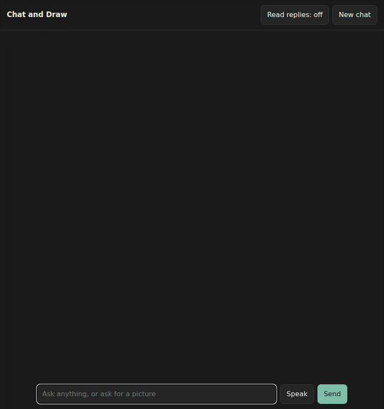

# train_llm: training a small chat model from scratch

English | [中文](README_zh.md)

From the tokenizer through pretraining and SFT to reinforcement learning, this trains a small chat model that can call
tools, "Guangmingxing" (GMX), and evaluates every stage the same way [nanochat](https://github.com/karpathy/nanochat)
does. On top of that model come image understanding and conversational image generation in English, with the model
seeing the pictures it draws.

The architecture, optimizer and training pipeline follow nanochat closely, with [minimind](https://github.com/jingyaogong/minimind)
as a further reference. Added on top:
- Tool calling: a calculator, and any tool defined in the hermes function-calling format
- vLLM for RL rollouts and chat evaluation
- RL with a KL penalty, and resumable training
- Image understanding and conversational image generation, see "Multimodal"



Speaking to it and hearing the replies (with sound):


https://github.com/user-attachments/assets/e6dec5dc-ca50-46ee-a1c4-30a7ca3b3202


## Results

| Metric | d12 (one GPU) | d24 (2 × 32GB) |
|---|---|---|
| Layers / width / heads | 12 / 768 / 6 | 24 / 1536 / 12 |
| Parameters (Transformer + lm_head / total) | 0.14B / 0.49B | 0.78B / 2.1B |
| **Base** CORE | 0.150 | **0.248** |
| Base val bpb | 0.874 | 0.750 |
| **SFT** ARC-Easy / ARC-Challenge | 0.385 / 0.340 | 0.628 / 0.482 |
| SFT MMLU | 0.324 | 0.379 |
| SFT GSM8K / HumanEval | 0.064 / 0.055 | 0.124 / 0.146 |
| SFT ChatCORE | 0.103 | 0.251 |
| **RL** GSM8K | 0.069 | **0.178** |
| RL ChatCORE | 0.101 | **0.262** |

- Parameters are given twice because most of them sit in lookup tables such as the value embeddings; the computation
  happens in the Transformer and the lm_head.
- d24 reaches a CORE of 0.248, close to GPT-2 (1.5B) at 0.256. Pretraining used nanochat's FineWeb-Edu data with 8 tokens
  per parameter, about 6.2B tokens, in about 38 hours on two 32GB GPUs.
- The d24 RL result comes from the setup in "Reinforcement learning": GSM8K up 5.5 points, the other tasks about the same.
- Every run writes `weight/<config>/report/report.md`, comparing base, SFT and RL in full, with the score of every CORE task.

## Training pipeline

```
tokenizer → pretraining → base eval → SFT → chat eval → RL → chat eval → report                        (run_2gpu_d24.sh)
SFT → image align → image SFT → image RL → two rounds of conversational drawing → final model chat_t2i_v9  (run_d24_multimodal.sh)
```

| Stage | Script | Data / what it does |
|---|---|---|
| Tokenizer | `script/train_token.py` | BPE, 65,536 tokens, trained with [rustbpe](https://github.com/1023097618/rustbpe) |
| Pretraining | `script/pretrain.py` | karpathy/fineweb-edu-100b-shuffle, sequence length 2048, token count from the parameter count, batch size from Power Lines |
| Base eval | `script/base_eval.py` | CORE (22 DCLM tasks), validation bpb, sample continuations |
| SFT | `script/train_sft.py` | nanochat's mixture (SmolTalk + MMLU ×3 + GSM8K ×4), plus hermes tool calling, synthetic tool calling and identity conversations; the learning rate continues from pretraining |
| Chat eval | `script/chat_eval.py` | ARC-Easy/Challenge, MMLU, GSM8K, HumanEval, ChatCORE |
| RL | `script/chat_rl.py` | GSM8K-style math questions, reward for a correct answer; the calculator can be called while sampling |
| Report | `script/report.py` | one markdown table |
| Image understanding | `script/train_vlm.py` | frozen SigLIP2: first only the projector trains (align), then the chat model with it (sft), then RL; ALLaVA data |
| Conversational drawing | `script/train_vlm.py` | conversations that draw, change pictures and look at them, see "Multimodal" |

## Model and optimizer (`model/gpt.py`, `optimizer/optimizer.py`)

As in nanochat:
- **Architecture**: decoder-only, RoPE (base 100000), RMSNorm without learnable weights, QK norm, ReLU² MLP, a norm after the embedding as well.
- **Extra parts**: value embeddings every other layer, a learnable scale each on the residual stream and the input embedding, smear and backout.
- **Attention**: sliding window in the pattern SSSL, i.e. three of every four layers only see the previous 512 tokens. flex_attention in training.
- **Output**: logits soft-capped at ±15, input and output embeddings not tied.
- **Optimizer**: Muon for the matrices (Polar Express orthogonalization, NorMuon, cautious weight decay), AdamW for embeddings and scalars. Optimizer state sharded across GPUs with DDP.

## Reinforcement learning (`script/chat_rl.py`)

The base algorithm is nanochat's: on-policy REINFORCE / "GRPO", the advantage is the reward minus the mean reward over
the samples of the same question, the loss is normalized per token. Three additions, each can be switched on alone:
- `--kl_beta`: a KL penalty to the frozen SFT model, k3 estimator.
- `--oversample`: dynamic sampling (as in DAPO). More questions are sampled per step and only those whose 16 samples are
  partly right and partly wrong are trained on.
- `--train_data`: other training questions instead of GSM8K train.

d24 uses KL + dynamic sampling, with new GSM8K-style questions from OpenMathInstruct-2 (`script/prepare_rl_data.py`):
GSM8K goes from 0.124 after SFT to 0.178. With the same questions the gain is small: GSM8K train appears four times in
the SFT data and the model has memorized it (0.66 on train, 0.11 on test), so RL on those questions mostly rehearses
answers. `script/rl_filter.py` measures the SFT model's accuracy on each question, to pick questions of the right difficulty.

In RL, vLLM and the reference model share one GPU and the trained model uses the other: d24's training state plus vLLM
does not fit a 32GB GPU.

## Multimodal

One chat page chats, draws, changes pictures, answers questions about them, takes speech and reads replies aloud, in
English. Our own model holds the conversation, makes the decisions and sees the pictures; drawing and speech are
open-source models:

| Ability | What does it | Source |
|---|---|---|
| Chatting, deciding to draw, writing and changing descriptions | the d24 chat model | trained here |
| Seeing pictures (including its own) | frozen SigLIP2 + projector + d24 (`script/train_vlm.py`) | projector and chat model trained here |
| Drawing and changing pictures | [Z-Image-Turbo](https://huggingface.co/Tongyi-MAI/Z-Image-Turbo) (Apache 2.0) | open source |
| Speech to text | [SenseVoice](https://huggingface.co/FunAudioLLM/SenseVoiceSmall) | open source |
| Text to speech | [Kokoro](https://huggingface.co/hexgrad/Kokoro-82M) (Apache 2.0) | open source |

**One drawing turn** (`inference/chat_t2i.py`, `tokenizer/tokenizer.py`):

```text
<|user|>make the car green<|/user|>
<|assistant|>The car is now green.
<|edit prompt|><|image ref|>0<|/image ref|>A green car on a road.<|/edit prompt|>      the model writes: change picture 0, the complete new description
<|image|><|image ref|>1<|/image ref|><|image pad|>×64<|/image|><|/assistant|>          the program puts back: the new picture's number and the picture
```

- **Seeing**: SigLIP2 turns the picture into 64 vectors that replace the embeddings at the `<|image pad|>` positions, so the
  model sees what it drew, not only the description.
- **Changing a picture**: the program finds the picture by its number and gives it to Z-Image-Turbo with the new
  description (image to image). No single strength suits every change, so it starts low and raises the strength until
  SigLIP2 finds the result closer to the new description than to the old one (`inference/image_backend.py`). Image to
  image touches the whole picture a little, the background is not kept pixel for pixel.
- **Going back**: when the description equals that of the referenced picture, that picture is returned as it was.

**Training data**: no ready-made data was found for this (the [DialogBen](https://hunyuan-dialoggen.github.io) data is not
released), so all of it is synthetic:

| Data | What it is |
|---|---|
| ~30,000 conversations | templates and DeepSeek; each kind is checked by a program, e.g. how many words an edit keeps, whether a replaced color is gone |
| ~24,000 pictures | the pictures of 14,000 of those conversations, really drawn with Z-Image-Turbo |
| 7,073 question-answer pairs about pictures | written by a DeepSeek model that looks at the picture, without the description |
| 20,000 "draw, then look" conversations | real ALLaVA images: the first sentence of the caption as the description, the full caption when asked what is in the picture |

The original SFT and image data are mixed in (`run_d24_multimodal.sh`) to keep the other abilities.

**Results** (final model `chat_t2i_v9`, new hand-written questions, top-k 2, 3 tries each, `script/t2i_chat_eval.py`):

| Metric | Result |
|---|---|
| Draws when asked / stays in text otherwise | 1.00 / 1.00 |
| Edits with `<\|edit prompt\|>` referring to the right picture | 0.98 |
| Goes back to an earlier picture | 0.92 |
| A vague change ("cuter") really changes the description | 1.00 |
| Attribute swap ("make the car yellow") | 0.89 |
| Edit correct (keyword rule) | 0.87 |
| Every detail the user gave is in the description | 0.73 |
| **Questions only the picture answers** (the description does not say): real picture / gray picture | **1.00 / 0.03** |
| Says it is Guangmingxing, 20 ways of asking who it is (3 tries each) | 59 / 60 |

Keyword rules on few questions: a rough guide only.

| Earlier abilities | After image RL (`vlm_rl`) | Final model (`chat_t2i_v9`) |
|---|---|---|
| ChatCORE | 0.250 | 0.250 |
| ARC-Easy / ARC-Challenge | 0.629 / 0.490 | 0.613 / 0.489 |
| MMLU | 0.379 | 0.379 |
| HumanEval | 0.079 | 0.140 |
| **GSM8K** | 0.173 | **0.136** |
| Image understanding (mean centered accuracy) | 0.218 | 0.222 |

The final model's GSM8K and HumanEval were measured on an 8GB GPU (vLLM with at most 1024 tokens), everything else on
32GB GPUs. GSM8K drops most likely because the drawing training came after RL and undid part of it; this was not tested separately.

**Known issues**: everyday chat is limited (e.g. it is bad at suggesting names); arithmetic goes wrong; it often gets
details and counts in pictures wrong and may describe things that are not there; it sometimes drops details the user
asked for; a change the reply announces is not always in the picture.

**Running the page**:

```bash
python -m script.download_release --what=weights    # final model and tokenizer
python -m script.download_image_backend            # Z-Image-Turbo
python -m script.download_vlm                       # only SigLIP2 of it is needed here
python -m script.download_audio                     # SenseVoice, Kokoro (speech is optional)
pip install funasr kokoro "misaki[en]"              # speech is optional; without it add --voice=0
python -m script.chat_t2i_web --chat_ckpt=weight/d24/chat_t2i_v9.ckpt --tokenizer_path=weight/d24/tokenizer.pkl
ssh -L 8765:127.0.0.1:8765 <gpu machine>   # when it runs on a remote machine, then browse http://localhost:8765
```

The page listens on localhost only and has no content filter or login: do not expose it to the internet. It needs
about 28 GB of GPU memory.

## Published weights and data

The weights and the data made for this project are on Hugging Face; `python -m script.download_release` puts them where
the scripts expect them:

| What | Where | Download |
|---|---|---|
| Final model `chat_t2i_v9.ckpt` and tokenizer | [zhvhabqifova/guangmingxing-d24](https://huggingface.co/zhvhabqifova/guangmingxing-d24) | `--what=weights` |
| Synthetic conversations, drawn pictures, questions about pictures | [zhvhabqifova/guangmingxing-d24-data](https://huggingface.co/datasets/zhvhabqifova/guangmingxing-d24-data) | `--what=data` |

Only the final model is published, not the stages before it (pretraining, SFT, RL, the image rounds); reproducing from
scratch means running the training pipeline in order.

**Data** (`--what=data`):

| File | Rows | How it was made |
|---|---|---|
| `custom/identity_conversations_en_d24.jsonl` | 3349 | identity conversations by DeepSeek |
| `custom/identity_qa_d24.jsonl` | 526 | short identity questions by DeepSeek |
| `custom/identity_direct_d24.jsonl` | 2041 | by DeepSeek, many direct ways of asking who it is |
| `custom/toolcall_synth.jsonl` | 991 | by DeepSeek: retry after an error, ask for a missing argument, chained calls, no call needed |
| `custom/t2i_chat.jsonl` | 31348 | drawing, editing and chat conversations from templates and DeepSeek |
| `custom/t2i_chat_text.jsonl` | 6479 | those of them that draw nothing |
| `processed/chat/*.parquet` | 34,000 conversations, 44,011 pictures | the pictures drawn with Z-Image-Turbo, plus the "draw, then look" ALLaVA images |
| `processed/chat_labels/*.json` | 7073 | questions and answers about the pictures by DeepSeek looking at them |

All other data (FineWeb-Edu, SmolTalk, ALLaVA, ...) is public, downloaded by `script/download_*.py` and processed by `script/prepare_*.py`.

## Quick start

```bash
bash setup_env.sh          # conda environment gpt (PyTorch + vLLM + rustbpe + the multimodal packages), CUDA 13.0 by default, CUDA=cu128 to change
conda activate gpt

# the full pipeline in one command (each configuration keeps its weights in weight/<config>/)
setsid nohup bash run_single_gpu_8g.sh > log/d12.log 2>&1 < /dev/null &        # d12, fits one 8GB GPU
setsid nohup bash run_2gpu_d24.sh > log/d24.log 2>&1 < /dev/null &            # d24, two 32GB GPUs, GPU ids at the top of the script
setsid nohup bash run_d24_multimodal.sh > log/d24_mm.log 2>&1 < /dev/null &   # after d24: image understanding, drawing, the final model
```

- Data is downloaded automatically, through the hf-mirror.com mirror by default.
- The first two scripts run: download data → train the tokenizer → pretrain → base eval → SFT → chat eval → RL → chat eval → report.
- `run_d24_multimodal.sh` continues from d24's SFT model; run it again after an interruption and it skips finished
  stages and resumes the unfinished one from its training state.
- Every stage can also run alone; each `script/*.py` explains its usage at the top.

**Resuming**:
- Pretraining: add `--resume=1` to continue from the last checkpoint in `--save_ckpt_path`, with model, optimizer and data position.
- RL: the full training state is saved every 30 steps in `<save_ckpt_path>.state`. After a kill, run the same command with `--resume=<.state file>`.

**Chat and deployment**:
- `export_vllm.py`: exports a checkpoint into a directory vLLM loads, with the training chat template and tool calling.
- `evaluation/sample.py`: local multi-turn chat with tools, e.g. a calculator, time, weather, currency conversion.

## Layout

```
model/        the GPT (flex_attention in training, KV cache at inference)
optimizer/    Muon + AdamW (sharded with DDP)
tokenizer/    tokenizer and chat template (with tool calls)
tasks/        datasets for pretraining, SFT, evaluation and RL
script/       entry points: download, train, evaluate, RL, report
evaluation/   CORE, bpb, code execution (HumanEval), chat sampling
inference/    PyTorch inference engine, vLLM adapter, conversational drawing, image and speech back ends
common/       paths, checkpoint helpers, report files
run_*.sh      the full pipelines for each hardware setup, and d24's multimodal training
```

## What could come next

- RL: more steps or a second epoch (this run used about 7,500 of the 30,000 new questions); asynchronous RL that overlaps
  sampling and training; RL on tool calling.
- Serving and faster inference with vLLM.
- Conversational drawing: inpainting or a dedicated editing model to keep the background really unchanged; another RL
  round at the end to win back GSM8K; pictures uploaded by the user.

## Acknowledgements

- [karpathy/nanochat](https://github.com/karpathy/nanochat): architecture, optimizer, training pipeline and evaluation
- [jingyaogong/minimind](https://github.com/jingyaogong/minimind): the first reference of the project; MiniMind-V for image understanding
- Models: SigLIP2, Z-Image-Turbo, SenseVoice, Kokoro
- Datasets: FineWeb-Edu, SmolTalk, MMLU, GSM8K, NousResearch/hermes-function-calling-v1, nvidia/OpenMathInstruct-2, DCLM CORE eval bundle, ARC, HumanEval, ALLaVA, text-to-image-2M
