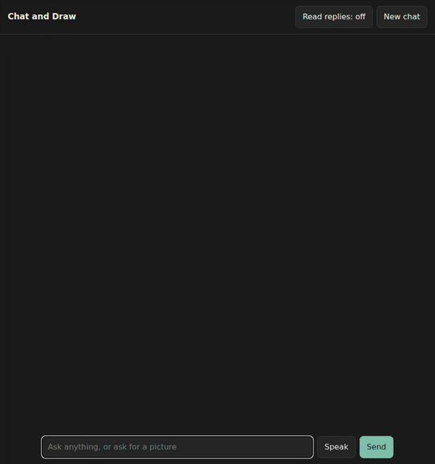

# train_llm：从零训练一个小型对话模型

从分词器、预训练、SFT 到强化学习，完整训练一个能对话、会调用工具的小语言模型“光明星”（Guangmingxing，GMX），并用和 [nanochat](https://github.com/karpathy/nanochat) 相同的方法评测每个阶段。在这个模型上，又加了看图能力和英文的对话式生图，模型能看到自己画的图。

模型结构、优化器和训练流程基本对齐 nanochat，同时参考了 [minimind](https://github.com/jingyaogong/minimind)。在此基础上加了几样东西：
- 工具调用：计算器，以及按 hermes function-calling 格式定义的任意工具
- 用 vLLM 做 RL 采样和对话评测
- 带 KL 约束的 RL，以及可以续跑的训练
- 看图和对话式生图，见“多模态”一节



*对话页面的真实录屏（等待出图的几秒做了加速，多录了几次，选了改图效果最好的一次）。图由 Z-Image-Turbo 画，什么时候画、怎么写和改描述由我们训练的模型决定。*

## 结果

| 指标 | d12（单卡） | d24（2 × 32GB） |
|---|---|---|
| 层数 / 宽度 / 头数 | 12 / 768 / 6 | 24 / 1536 / 12 |
| 参数（Transformer + lm_head / 总计） | 0.14B / 0.49B | 0.78B / 2.1B |
| **Base** CORE | 0.150 | **0.248** |
| Base val bpb | 0.874 | 0.750 |
| **SFT** ARC-Easy / ARC-Challenge | 0.385 / 0.340 | 0.628 / 0.482 |
| SFT MMLU | 0.324 | 0.379 |
| SFT GSM8K / HumanEval | 0.064 / 0.055 | 0.124 / 0.146 |
| SFT ChatCORE | 0.103 | 0.251 |
| **RL** GSM8K | 0.069 | **0.178** |
| RL ChatCORE | 0.101 | **0.262** |

- 参数分两列给出，是因为大部分参数在 value embedding 这类查表上，真正参与计算的是 Transformer 和 lm_head 那部分。
- d24 的 CORE 是 0.248，接近 GPT-2（1.5B）的 0.256。预训练用了 nanochat 的 FineWeb-Edu 数据，按参数量的 8 倍取 token，约 62 亿 token；在两张 32GB 卡上跑了约 38 小时。
- d24 的 RL 结果来自下面“强化学习”一节里的配置：GSM8K 提高了 5.5 个点，其他任务基本不变。
- 每次运行都会生成 `weight/<配置>/report/report.md`，里面是 base、SFT、RL 三个阶段的完整对比，以及 CORE 每个子任务的分数。

## 训练流程

```
分词器 → 预训练 → base 评测 → SFT → chat 评测 → RL → chat 评测 → report         （run_2gpu_d24.sh）
SFT → 看图 align → 看图 SFT → 看图 RL → 对话生图两轮 → 最终模型 chat_t2i_v9       （run_d24_vlm*.sh、run_d24_t2i_chat.sh）
```

| 阶段 | 脚本 | 数据 / 内容 |
|---|---|---|
| 分词器 | `script/train_token.py` | BPE，65536 词表，用 [rustbpe](https://github.com/1023097618/rustbpe) 训练 |
| 预训练 | `script/pretrain.py` | karpathy/fineweb-edu-100b-shuffle，序列长度 2048，按参数量自动定 token 数，Power Lines 自动定 batch size |
| base 评测 | `script/base_eval.py` | CORE（DCLM 的 22 个任务）、验证集 bpb、续写样例 |
| SFT | `script/train_sft.py` | nanochat 的数据配比（SmolTalk + MMLU ×3 + GSM8K ×4），加上 hermes 工具调用数据、合成工具调用数据和身份对话；学习率接着预训练的往下走 |
| chat 评测 | `script/chat_eval.py` | ARC-Easy/Challenge、MMLU、GSM8K、HumanEval、ChatCORE |
| RL | `script/chat_rl.py` | GSM8K 风格的数学题，奖励是答案对就得分；采样时可以调用计算器 |
| 报告 | `script/report.py` | 汇总成一张 markdown 表 |
| 看图 | `script/train_vlm.py` | 冻结的 SigLIP2，先只训练投影层（align），再连同对话模型一起训练（sft），最后做 RL；数据是 ALLaVA |
| 对话生图 | `script/train_vlm.py` | 画图、改图、看自己画的图的对话，见“多模态”一节 |

## 模型与优化器（`model/gpt.py`，`optimizer/optimizer.py`）

和 nanochat 对齐：
- **结构**：decoder-only，RoPE（base 100000），RMSNorm 不带可学习参数，QK norm，ReLU² MLP，embedding 之后也做一次 norm。
- **额外部件**：每两层有一组 value embedding，残差流和输入 embedding 各有一个可学习的缩放系数，还有 smear 和 backout。
- **注意力**：滑动窗口，模式是 SSSL，即每 4 层里有 3 层只看前 512 个 token。训练时用 flex_attention。
- **输出**：logit 软截断到 ±15，输入和输出 embedding 不共享。
- **优化器**：矩阵参数用 Muon（Polar Express 正交化、NorMuon、cautious weight decay），embedding 和标量参数用 AdamW。多卡时优化器状态按 DDP 分片。

## 强化学习（`script/chat_rl.py`）

基础算法和 nanochat 一致：on-policy 的 REINFORCE / “GRPO”，advantage 是奖励减去同一道题所有样本奖励的均值，loss 按 token 归一化。在这个基础上额外加了三件事，都可以单独开关：
- `--kl_beta`：对冻结的 SFT 模型加 KL 惩罚，用 k3 估计。
- `--oversample`：动态采样（DAPO 的做法）。每步多采样一些题，只训练“16 个样本里有对有错”的那些题。
- `--train_data`：换一套训练题，不用 GSM8K train。

d24 用的配置是 KL + 动态采样，训练题换成 OpenMathInstruct-2 里仿 GSM8K 风格新写的题（`script/prepare_rl_data.py`），GSM8K 从 SFT 的 0.124 提高到 0.178。不换题时效果很小：SFT 数据里 GSM8K train 重复了 4 遍，模型已经背下了这些题（训练集正确率 0.66，测试集只有 0.11），在同一批题上做 RL 主要是在复习答案。`script/rl_filter.py` 可以用 SFT 模型给每道题测一次正确率，帮助挑选难度合适的题。

RL 阶段，vLLM 和参考模型放在一张卡上，训练模型放在另一张卡上，因为 d24 的训练状态加上 vLLM 放不进一张 32GB 的卡。

## 多模态

一个对话页面可以聊天、画图、改图、问图里有什么，也能语音输入和朗读回复，只支持英文。自己训练的模型负责对话、决策和看图，画图和语音交给开源模型：

| 能力 | 用什么 | 来源 |
|---|---|---|
| 聊天、判断是否画图、写和改绘图描述 | d24 对话模型 | 自己训练 |
| 看图（包括自己画的图） | 冻结的 SigLIP2 + 投影层 + d24（`script/train_vlm.py`） | 投影层和对话模型自己训练 |
| 画图、改图 | [Z-Image-Turbo](https://huggingface.co/Tongyi-MAI/Z-Image-Turbo)（Apache 2.0） | 开源 |
| 听写 | [SenseVoice](https://huggingface.co/FunAudioLLM/SenseVoiceSmall) | 开源 |
| 朗读 | [Kokoro](https://huggingface.co/hexgrad/Kokoro-82M)（Apache 2.0） | 开源 |

**一轮画图对话**（`inference/chat_t2i.py`、`tokenizer/tokenizer.py`）：

```text
<|user|>make the car green<|/user|>
<|assistant|>The car is now green.
<|edit prompt|><|image ref|>0<|/image ref|>A green car on a road.<|/edit prompt|>      模型写：改第 0 张，以及完整的新描述
<|image|><|image ref|>1<|/image ref|><|image pad|>×64<|/image|><|/assistant|>          程序放回：新图的编号和图片
```

- **看图**：SigLIP2 把图片变成 64 个向量，替换 `<|image pad|>` 位置的 embedding，所以模型能看到自己画的图，而不只是描述。
- **改图**：程序按编号找到原图，连同新描述交给 Z-Image-Turbo 做图生图。没有一个固定强度适合所有改动，所以从低强度开始，每次用 SigLIP2 判断结果是否更像新描述，不够就加大（`inference/image_backend.py`）。图生图会轻微改动整张图，背景不是像素级不变。
- **回到之前的图**：描述和被引用的图完全相同时，直接返回那张图。

**训练数据**：网上没有找到能直接用的对话数据（[DialogBen](https://hunyuan-dialoggen.github.io) 还没有放出数据），所以都是合成的：

| 数据 | 内容 |
|---|---|
| 约 3 万条对话 | 模板和 DeepSeek 合成，每类都有程序校验，比如改图后新旧描述的词语重合度、被替换的颜色是否消失 |
| 约 2.4 万张图 | 用 Z-Image-Turbo 把其中 1.4 万条对话里的图真的画出来 |
| 7073 组看图问答 | 让能看图的 DeepSeek 模型看着图写问答，不给它描述 |
| 2 万条“先画再看” | ALLaVA 的真实图，第一句作描述，问“图里有什么”时答完整描述 |

训练时混入原有的 SFT 和看图数据（`run_d24_t2i_chat.sh`），以尽量保留原有能力。

**结果**（最终模型 `chat_t2i_v9`，手写的新问题，top-k 2，每题 3 次，`script/t2i_chat_eval.py`）：

| 指标 | 结果 |
|---|---|
| 该画时会画 / 不该画时不画 | 1.00 / 1.00 |
| 改图时使用 `<\|edit prompt\|>` 并引用正确的图 | 0.98 |
| 回到之前的图 | 0.92 |
| 模糊修改（“更可爱”）确实改了描述 | 1.00 |
| 属性替换（“把车改成黄色”） | 0.89 |
| 改图正确（关键词规则） | 0.87 |
| 用户提到的细节都写进描述 | 0.73 |
| **只有看图才能答对的问题**（描述里不提答案）：真图 / 灰图 | **1.00 / 0.03** |
| 20 种问身份的说法里答出自己是光明星（各 3 次） | 59 / 60 |

这些是关键词规则的分数，题量也小，只能作粗略参考。

| 原有能力 | 看图 RL 之后（`vlm_rl`） | 最终模型（`chat_t2i_v9`） |
|---|---|---|
| ChatCORE | 0.250 | 0.250 |
| ARC-Easy / ARC-Challenge | 0.629 / 0.490 | 0.613 / 0.489 |
| MMLU | 0.379 | 0.379 |
| HumanEval | 0.079 | 0.140 |
| **GSM8K** | 0.173 | **0.136** |
| 看图（居中准确率均值） | 0.218 | 0.222 |

最终模型的 GSM8K 和 HumanEval 是在一张 8GB 显卡上评测的（vLLM 最长 1024 个 token），其余数字都在 32GB 的卡上。GSM8K 下降，很可能是因为对话生图的训练在 RL 之后，冲掉了 RL 的部分收益，这一点没有单独验证过。

**已知问题**：日常聊天能力有限（比如起名字答得很差）；算术也会出错；看图时细节和数量常出错，也可能说看到了图里没有的东西；模型有时把用户的细节漏掉；回复说的改动不一定都画出来了。

**运行页面**：

```bash
python -m script.download_release --what=weights    # 最终模型和分词器
python -m script.download_image_backend            # Z-Image-Turbo
python -m script.download_vlm                       # 只用到其中的 SigLIP2
python -m script.download_audio                     # SenseVoice、Kokoro
# diffusers 和 Kokoro 的依赖装在训练环境之外，安装命令写在 inference/image_backend.py 和 inference/speech_io.py 开头
PYTHONPATH=~/train_llm_pylibs/image CUDA_VISIBLE_DEVICES=1 ~/train_llm_pylibs/voice/bin/python -m script.chat_t2i_web \
    --chat_ckpt=weight/d24/chat_t2i_v9.ckpt --tokenizer_path=weight/d24/tokenizer.pkl
ssh -L 8765:127.0.0.1:8765 <服务器>   # 然后打开 http://localhost:8765
```

页面只监听本机地址，没有内容过滤，也没有登录，不要直接暴露到公网。显存约需 28 GB。

## 公开的权重和数据

权重和本项目自己生成的数据都放在 Hugging Face 上，用 `python -m script.download_release` 下载到脚本默认读取的位置：

| 内容 | 地址 | 下载 |
|---|---|---|
| 最终模型 `chat_t2i_v9.ckpt` 和分词器 | [zhvhabqifova/guangmingxing-d24](https://huggingface.co/zhvhabqifova/guangmingxing-d24) | `--what=weights` |
| 合成的对话、画好的图、看图问答 | [zhvhabqifova/guangmingxing-d24-data](https://huggingface.co/datasets/zhvhabqifova/guangmingxing-d24-data) | `--what=data` |

只公开了最终模型，中间阶段（预训练、SFT、RL、看图的各轮）没有公开，从头复现要按“训练流程”依次跑。

**数据**（`--what=data`）：

| 文件 | 条数 | 生成方式 |
|---|---|---|
| `custom/identity_conversations_en_d24.jsonl` | 3349 | DeepSeek 生成的身份对话 |
| `custom/identity_qa_d24.jsonl` | 526 | DeepSeek 生成的简短身份问答 |
| `custom/identity_direct_d24.jsonl` | 2041 | DeepSeek 生成，各种直接问身份的说法 |
| `custom/toolcall_synth.jsonl` | 991 | DeepSeek 生成：出错后重试、缺参数先追问、连续调用、不该调用 |
| `custom/t2i_chat.jsonl` | 31348 | 模板和 DeepSeek 合成的画图、改图、聊天对话 |
| `custom/t2i_chat_text.jsonl` | 6479 | 其中不画图的对话 |
| `processed/chat/*.parquet` | 34000 条对话，44011 张图 | 对话里的图用 Z-Image-Turbo 画好，加上 ALLaVA 图片的“先画再看” |
| `processed/chat_labels/*.json` | 7073 组 | DeepSeek 看着图写的问答 |

其余数据（FineWeb-Edu、SmolTalk、ALLaVA 等）都是公开数据集，由 `script/download_*.py` 下载、`script/prepare_*.py` 处理。

## 快速开始

```bash
bash setup_env.sh          # 创建 conda 环境 gpt（PyTorch + vLLM + rustbpe），默认 CUDA 13.0，可以用 CUDA=cu128 改
conda activate gpt

# 一键跑完整流程（每个配置的权重放在 weight/<配置>/ 下，互不干扰）
setsid nohup bash run_single_gpu_8g.sh > log/d12.log 2>&1 < /dev/null &   # d12，单卡 8GB 就能跑
setsid nohup bash run_2gpu_d24.sh > log/d24.log 2>&1 < /dev/null &       # d24，两张 32GB，GPU 编号写在脚本开头
```

- 数据会自动下载，默认走 hf-mirror 镜像。
- 每个脚本都依次执行：下载数据 → 训练分词器 → 预训练 → base 评测 → SFT → chat 评测 → RL → chat 评测 → report。
- d24 的多模态部分接着依次跑 `run_d24_rl_omi.sh`（准备 RL 题目）、`run_d24_vlm.sh`、`run_d24_vlm_rl.sh`、`run_d24_t2i_chat.sh`，各脚本开头写了需要的数据。
- 也可以单独跑某个阶段，每个 `script/*.py` 文件开头都写了用法。

**续跑**：
- 预训练：加 `--resume=1`，从 `--save_ckpt_path` 里最近一次保存的 checkpoint 接着跑，包括模型、优化器和数据位置。
- RL：每 30 步保存一次完整的训练状态，存在 `<save_ckpt_path>.state`。被 kill 后，用原来的命令加上 `--resume=<.state 文件>` 就能接着跑。

**对话与部署**：
- `export_vllm.py`：把 checkpoint 导出成 vLLM 能加载的目录，chat template 和训练时一致，支持工具调用。
- `evaluation/sample.py`：本地带工具的多轮对话采样，示例工具有计算器、时间、天气、汇率换算等。

## 目录

```
model/        GPT 模型（训练用 flex_attention，推理用 KV cache）
optimizer/    Muon + AdamW（DDP 分片）
tokenizer/    分词器和对话模板（带工具调用）
tasks/        预训练、SFT、评测和 RL 的数据集
script/       各阶段入口：下载数据、训练、评测、RL、报告
evaluation/   CORE、bpb、代码执行（HumanEval）、对话采样
inference/    PyTorch 推理引擎、vLLM 适配、对话生图、画图和语音后端
common/       路径、checkpoint 工具、report 读写
run_*.sh      不同硬件配置的完整流程，以及 d24 的 RL 和多模态脚本
```

## 后续方向

- RL：增加训练步数，或者跑第二个 epoch（这次只用了 3 万道新题里的约 7500 道）；尝试异步 RL，让采样和训练重叠进行；做工具调用方向的 RL。
- 用 vLLM 做部署和加速推理。
- 对话生图：用局部重绘或专门的编辑模型，让背景真正保持不变；在最后再跑一轮 RL，找回 GSM8K；让用户也能上传图片。

## 致谢

- [karpathy/nanochat](https://github.com/karpathy/nanochat)：模型结构、优化器、训练流程和评测
- [jingyaogong/minimind](https://github.com/jingyaogong/minimind)：项目最初的参考；看图参考了 MiniMind-V
- 模型：SigLIP2、Z-Image-Turbo、SenseVoice、Kokoro
- 数据集：FineWeb-Edu、SmolTalk、MMLU、GSM8K、NousResearch/hermes-function-calling-v1、nvidia/OpenMathInstruct-2、DCLM CORE eval bundle、ARC、HumanEval、ALLaVA、text-to-image-2M
